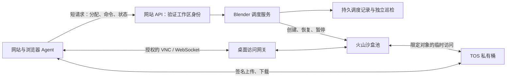

# Blender 云服务实施计划

更新：2026-10-11。状态：用户已选择 Cloudflare 调度方案，ECS 购买搁置。单工程开发预览已验收；持久调度、多实例队列、工程检查点、任务恢复和生产入口已有实现及真实云端验证，新 managed 镜像已上传，TOS 私有桶已创建。**Cloudflare 与网站已部署；真实 TOS、同实例暂停/恢复、后台隔离并行批次、GLB 导出下载、桌面 WebSocket 握手/撤销、Chrome 输入及保存后重连、网站模型领取均已通过。跨用户可信复用及人工/Agent 控制权切换仍待完成，整项计划尚未全部交付。** 下文目标不能直接当作线上能力；以末尾实施记录及 `deploy/blender-cloudflare/README.md` 为准。

## 1. 目标与已确定的方向

把 Blender 做成网站按需调用的共享算力服务。用户需要建模或打开远程 Blender 时才分配工作环境；不使用 Blender 的用户不占用沙盒。

- 采用火山云沙盒，第一候选为 **veFaaS 云沙箱**；具体地域、账号权限和图形环境兼容性由 Phase 0 核实。
- 工程与产物保存在私有 **TOS 存储桶**。
- **必须运行用户的特殊定制 Blender 环境**。定制程序、插件、脚本、默认配置和运行依赖组成版本化容器镜像；沙盒从该镜像启动，禁止用普通官方版替换。
- 沙盒不永久绑定用户；同一个沙盒可以先后服务不同用户。
- 一个活跃编辑会话暂时独占一个沙盒和其中的 Blender。多人同时使用时分配多个沙盒，不共用同一个 Blender 场景。
- 同一个用户、工作区或项目可以同时开启多个独立 Blender，用于批量建模。每个批次子任务建立自己的会话，分别运行、保存和暂停；并发数由额度控制，不硬性限制为一个。
- 工作完成后保存、清理并**暂停**沙盒，下一次按需恢复；不把销毁作为正常结束动作。
- 网页画面先采用 VNC 远程桌面，优先验证现有 KasmVNC 镜像；火山 AIO 的 VNC 是备选。RTC/WTN 视频推流留待实测后决定。
- 网站现有项目、聊天和资产仍以浏览器本地存储为主；新增云端存储范围限于 Blender 工程、输入输出和服务调度记录。

“共享”指共享可调度的资源池；工程所有权始终属于对应工作区。暂停池、运行中的空闲池和平台预热池分别计数，不能混为一谈。

## 2. 现状与接入缺口

以下为本次读取仓库确认的现状，不代表已验证云端运行：

| 现状 | 代码或文档 | 实施影响 |
| --- | --- | --- |
| Vercel 版在浏览器 Worker 内执行 Agent，Blender 配置关闭 | `app/src/browser/config.ts`、`app/src/browser/agentCompat.ts`、`deploy/README.md` | 不能只打开 `BLENDER_ENABLED`，需新增可在浏览器调用的远程工具适配 |
| 本地 Blender MCP 使用 `Bun.spawn` 和进程内单例 | `chat/src/models/blenderMcp.ts` | 云端连接必须按会话路由，禁止多个用户共享全局 MCP 客户端 |
| 导出从宿主机共享目录读取 GLB 后发布 | `chat/src/mastra/tools/blenderOps.ts` 的 `mapWorkdirPath`、`runBlenderExport` | 远程导出改为沙盒上传 TOS、浏览器取回并发布，不能只改主机地址 |
| 画面地址固定为 `/blender-live/`，代理由 Vite 插件提供 | `app/src/widgets/BlenderLive/index.tsx`、`app/blenderLiveProxy.ts` | 生产环境需要按会话签发画面入口和 WebSocket 路由 |
| 当前云端 API 是无状态供应商转发 | `api/server.ts`、`chat/src/cloud/proxy.ts` | 另建 Blender 调度服务，不把长期会话和桌面连接塞进现有转发请求 |
| 已有服务端签名的匿名工作区 Cookie | `chat/src/cloud/identity.ts` | 可用于受限试用身份关联；不是用户账号、跨设备身份或可靠付费额度体系 |
| Blender 镜像、补丁、GUI 启动脚本已存在 | `blender/docker/`、`blender/patch/` | 优先复用固定版本与已知行为，云端重新验证启动链、插件和画面 |

## 3. 火山能力边界

截至本次调研，官方文档说明：

- 暂停与恢复需要申请邀测，且只对开通后新建的实例生效。
- 暂停保留文件系统，不保留进程、内存或网络连接；恢复时必须重建桌面、Blender 与 MCP 连接。[暂停与恢复](https://docs.volcengine.com/docs/vefaas/Sandboxinstancepauseandresume?lang=zh)
- 运行中实例按规格持续计费，暂停期间不产生 CPU、内存费用；外部存储独立计费，实例预热池中的空闲实例也计费。文档列出的实例生命周期设置上限为 1440 分钟，到期进入删除流程。[云沙箱计费](https://docs.volcengine.com/docs/vefaas/pay-as-you-go-cloud-sandbox?lang=zh)
- 自定义镜像需进入火山 CR 并完成镜像预热；这与维持运行中的预热实例不是同一件事。[沙箱镜像](https://docs.volcengine.com/docs/vefaas/Sandbox_images?lang=zh)
- AIO 上游包含 `/vnc/index.html` 远程桌面入口；尚未证明本项目的 Blender 能在其图形环境中正常运行。[AIO 项目](https://github.com/agent-infra/sandbox/blob/main/README.md)
- TOS 提供预签名上传和下载能力，可用于按对象签发临时访问。[预签名 URL](https://docs.volcengine.com/docs/6349/156107)

**未确认项**：暂停是否冻结到期计时、暂停快照的最长保留时间、续期上限及恢复后的到期语义、实际可用规格与 GPU、图形驱动兼容性、WebSocket 持续连接限制、iframe 嵌入条件、账号配额和实际费用。Phase 0 需要逐项记录控制台/API 结果或工单答复。

本计划的“保留暂停沙盒”以平台允许的生命周期为边界，不承诺实例永久存在。平台回收后，工程必须能够从 TOS 在新实例恢复。

## 4. 服务组成



网站 API 只做身份验证、签发短期请求凭证和转发短请求。画面流经过支持长连接的桌面网关，具体部署位置在 Phase 0 确定。不得依赖现有 Vercel 函数承担持续的桌面 WebSocket。

调度服务管理沙盒、租约、命令、检查点与产物记录。第一版建议单副本、小规格常驻进程，使用持久盘上的 SQLite 事务保存控制记录，并定期备份；这是待实施的技术选择，不是当前已有设施。项目全文与聊天不迁入该数据库。

选择这一方式是为了明确处理分配互斥和进程重启。TOS 保存文件，不用普通 JSON 对象读写冒充跨请求锁。若以后增加调度服务副本，先换成支持共享事务与互斥的存储，再扩容。

调度服务也有基础运行成本；“空闲沙盒停止计算计费”不等于整个服务零成本。

### 4.1 定制 Blender 的保存与分发

| 内容 | 权威保存位置 | 使用方式 |
| --- | --- | --- |
| 定制 Blender 程序、插件、脚本、默认配置、字体与运行依赖 | 火山 CR 中按摘要固定的容器镜像 | 每个沙盒从同一版本镜像创建，各自运行独立 Blender |
| 定制发行包、定制源码/补丁和构建清单的归档 | 源码仓库及可选的私有 TOS 发布归档 | 用于备份和重建镜像，不要求每次启动从桶里重新下载安装 |
| 用户 `.blend`、贴图、输入素材与导出模型 | 私有 TOS 工程目录 | 按会话下载、编辑、上传和恢复 |
| Blender 进程、当前场景与运行时临时文件 | 运行中的沙盒 | 进程和内存不依赖暂停保留，工程靠已提交检查点恢复 |

“一个镜像，多份运行实例”：并行开启多个 Blender 时，每个沙盒都获得对应定制版本的运行环境，不需要为每个用户制作一套镜像。镜像仓库保留发布版本；实例暂停或平台回收不会删除镜像发布物。

当前仓库 Dockerfile 从 `docker/vendor/blender-5.2.2-linux-x64.tar.xz` 安装到 `/opt/blender`，再运行 `blender/patch/install.py`。这只能证明仓库的构建路径，**不能证明用户实际定制内容已全部包含**；Phase 0 需盘点实际使用环境，确认程序本体修改、插件、默认工程、配置、字体和依赖，形成清单并与本地行为对照。如果定制涉及程序本体，镜像必须使用对应 Linux 版本的定制构建产物，不能用同版本号的官方包替代。

为定制发行版分配 `buildId`，记录程序及插件校验值、镜像摘要和启动自检结果。调度按该摘要创建实例，检查点携带 `buildId` 和镜像摘要。升级发布新镜像，不覆盖旧版本；旧工程迁移先验证兼容性，不自动换版。

清理会话时只重置用户可写环境，再恢复经过验证的定制默认配置；不得把必要插件或定制配置当成临时文件删除。使用 AIO 备选时也必须打入完整定制版，不能只在 AIO 中安装普通 Blender 就算完成迁移。

## 5. 分配、暂停与复用

### 5.1 分配单位

服务端建立 `ownerId + projectId + sessionId` 的会话。项目标识来自浏览器工作区，服务端保存其归属关系；不能仅凭客户端传来的项目 ID 或 slug 授权。

沙盒资源记录与会话记录分开。沙盒只在租约有效期内分配给一个会话，每次分配生成新的 `leaseEpoch`。命令、上传回执、画面访问和任务完成回调均校验会话与代次，旧代次不得写入或操作新使用者的环境。

分配顺序：恢复可用的干净暂停实例 → 在总量额度内创建新实例 → 排队。已占用、正在清理或状态不明的实例不能被第二个会话借走。重复点击和网络重试通过幂等键返回同一分配结果。

同一项目可以存在多个 `sessionId`。重复连接同一个会话时复用现有租约；用户明确“新建 Blender”或批次创建新的 `itemId` 时分配新会话，不因为 `ownerId/projectId` 相同而合并。并行发生在会话之间，一个会话内的场景写操作仍然串行。

### 5.2 正常生命周期

1. 创建持久会话和分配意图，原子占用资源，再调用火山创建/恢复接口。
2. 启动桌面、Blender、会话执行器与 MCP，检查插件和引擎状态，载入 TOS 中的工程版本。
3. 服务端确认就绪后，才提供工具入口和短期画面凭证。
4. 同一轮工作复用会话，Blender 操作串行执行。用户接管编辑与 Agent 写场景互斥，提供明确的控制权切换。
5. 保存 `.blend` 与依赖，导出需要的 GLB，上传并验证 TOS 对象，提交检查点和产物清单。
6. 结束租约，撤销旧画面连接和权限，清理用户环境；确认可复用后暂停，放回干净暂停池。
7. 下次恢复时重新启动进程和网络连接，再分配新的租约。

资源状态至少包含：`creating / resuming / preparing / leased / saving / cleaning / pausing / paused-clean / quarantined / expired`。会话完成与浏览器已导入产物是两个独立状态。

调用暂停接口成功不代表已经暂停；必须查询平台状态确认。请求结果未知时先查询、核对资源标签，再决定是否重试，防止重复创建计费实例。

### 5.3 空闲与离线

以下是第一版待试用验证的建议值，不是平台限制或已经生效的配置：

| 参数 | 建议初值 | 解释 |
| --- | --- | --- |
| 运行中的预热空闲实例 | 0 | 第一版不为等待请求维持运行池 |
| 试用期全局活跃会话上限 | 4 | 超限排队；根据平台配额、预算和真实用量再调整 |
| 单工作区活跃会话上限 | 3 | 支持同一用户并行建模；同一会话的多标签页仍只允许一个写入控制者 |
| 无活动且无任务后的暂停等待 | 5 分钟 | 心跳、自动刷新和画面传输本身不算用户活动 |
| 浏览器离线宽限 | 2 分钟 | 已接收的任务继续，完成保存后暂停 |
| 检查点目标间隔 | 60 秒 | 在安全的命令边界保存，不能与修改场景并发 |
| 单次工作会话上限 | 60 分钟 | 到期前提示；续期受全局预算及平台到期时间约束 |

空闲必须同时满足：没有操作、没有在飞任务、没有导出上传、没有需要保存的未提交修改。用户长时间看画面时可明确续用，避免自动把网络心跳当成永久续租。

单会话闭环阶段，已接收的单条任务由云端执行器负责运行、保存和报结果。**当前浏览器 Agent 关闭后不会继续规划下一步**；该阶段只保证已接收命令能够收尾。批量建模阶段另行增加云端任务编排，承担已提交批次的后续步骤，见 §5.5；不能仅把单条命令投递并发就声称支持离线批量建模。

服务端独立巡检负责截止时间、超时中止、保存与暂停；网页关闭事件仅作辅助信号。沿用仓库 `taskPump` 的等待纪律，使用绝对到期时间，内部定时器失效时由外部 tick 推进；对云端增加独立于网页和被检查进程的周期触发源。

### 5.4 多用户复用的上线条件

Blender 工具可以执行 Python，仅清空场景或删除 `/workspace` **不足以证明跨用户安全**：脚本可能改动 HOME、启动文件、插件、后台进程和其他可写位置。

跨用户复用前必须验证：服务代码与基础配置不可被任务修改；租约可写环境能完整重置；旧进程、桌面连接、临时凭证全部失效；下一位只能访问自己的输入输出。凭证只授予本租约的具体对象，不把全桶密钥或网关签名密钥放进可执行 Python 的环境。

优先评估不可变基础环境加可替换的租约可写层，或平台支持的可信干净快照恢复能力；其在火山上的可行性属于 Phase 0/3 验证项。

若无法证明清理完整，实例进入隔离状态并暂停，不再分配给其他用户。公开多用户复用暂不开放，不把“重新启动 Blender”视为隔离验证通过。日常结束仍按用户选择执行暂停；异常实例的退役与删除策略另行确定，不自动扩大本次授权范围。

### 5.5 多 Blender 与批量建模

用户可以手动新增多个编辑会话，也可以提交批次，例如“制作桌子、椅子、灯各一个”。建议第一版将批次拆成独立子任务，不自动把它们合并到同一 `.blend` 工程。

```text
批次：制作三件家具
  item-A → session-A → 沙盒 A / Blender A → 桌子工程 + GLB → 保存后暂停
  item-B → session-B → 沙盒 B / Blender B → 椅子工程 + GLB → 保存后暂停
  item-C → session-C → 沙盒 C / Blender C → 灯具工程 + GLB → 保存后暂停
```

- 持久保存 `batchId / itemId / sessionId / operationId` 的关联。每个子任务有独立输入、目标资产、输出版本、状态和费用记录；后续工具调用显式带会话上下文，禁止通过界面“当前选中的 Blender”隐式路由后台任务。
- 第一版批次按独立项目项执行；有先后依赖的任务显式排队，工程合并和协作编辑留待后续设计。各子任务可以读取同一份不可变参考素材，但不同时写同一个工程文件。
- 批次大小与同时运行数量分开。例如提交 20 个模型、允许 3 个并行，则其余排队；每个子任务完成保存、清理且确认沙盒已暂停后释放名额，调度下一个。子任务失败不阻止无依赖的其他项完成。
- 名额计算包含创建、恢复、准备、执行、保存、清理和尚未确认暂停的实例。并发、CPU/内存额度、待排队任务数量和累计运行预算在服务端事务中统一预留，避免多个请求同时越限。
- 队列按工作区公平轮转，手动编辑也计入同一总额度。单个大批次不能长期占满全部名额；第一版不通过强制中断正在编辑的会话给别的批次让位。
- 云端编排器为每个已接收子任务持久保存步骤与工具结果，运行有步骤数、时间和调用预算的建模循环；模型服务凭证留在受信服务端。浏览器关闭后，已接收批次仍可调度和完成，重启后按回执恢复，不重复执行状态不明的场景修改。
- “等待用户回答”属于可见状态，保存工程并释放算力；用户回答后再恢复会话。已确认预算外的付费调用不自动追加。
- 单项重试创建新的尝试记录，只重试失败项；成功工程和产物继续保留。提供取消一项、取消剩余项和结束整批三个范围，取消后在安全边界保存并暂停，不删除已完成作品。
- 正常导出为各自独立资产。并发导入同一浏览器项目时，原子预留资产身份和版本序号，按 `itemId + exportId` 幂等发布；同一已有资产的版本更新检查预期修订号，冲突时保留两份结果并提示选择，不能静默覆盖。
- 批次显示每项排队/运行/待回答/保存/成功/失败/取消状态和已完成数量。部分失败时按部分完成呈现，用户可先领取成功项。
- 画面列表按会话切换，按需连接当前观看的 VNC，避免同时为所有后台会话持续传画面。关闭某个观看窗口不取消对应建模任务；单独结束一个会话也不暂停其他会话。
- 批量任务第一版继续运行已验证的 Blender GUI/插件，只是不必一直连接观看。无头模式需要单独验证 MCP 队列和 Blender 定时回调，不因“不看画面”直接切换为 `--background`。

用户提交前展示任务数、并行上限、预计资源规格和费用估算依据；实际费用按每个子任务的运行时间及存储/流量分别汇总。估算不是保证值，只有实际试用后才调整默认并发和规格。

### 5.6 一个用户调用多个沙盒与任务中断恢复

用户已明确要求：一个用户可以同时分配多个沙盒给 Agent 工作。用户/工程不是实例的永久绑定键；每个子任务分配独立 `sessionId` 和租约。采用 §5.3 的可配置并发额度，超额排队，不把单工程开发预览的进程内单例扩展为多个任务共享的“当前 Blender”。

调度服务必须持久保存用户请求、子任务步骤、工具输入和结果、`operationId`、当前检查点、资产发布状态及剩余预算。Agent 编排在受信服务端继续；沙盒只执行对应子任务。浏览器关闭和网页刷新不取消已接受的批次，多个子任务各自推进，某项失败不会中断其它无依赖任务。

| 中断情况 | 处理要求 |
| --- | --- |
| 浏览器断网、关闭页面或观看流断开 | 已提交任务继续，重新连接后按用户归属查询同一批次和步骤；不重新分配同一任务 |
| 调度服务重启 | 从持久记录恢复，核对平台实例、执行器回执和租约，再收养存活任务或进入恢复流程 |
| Blender 崩溃、沙盒被回收或生命周期到期 | 从 TOS 最新已提交的 `.blend`、依赖与步骤检查点在同版本定制镜像中恢复；换实例后发新租约代次 |
| 命令已发出但响应丢失 | 标记结果未知，先查询原 `operationId` 的持久回执并检查当前场景；不能直接重放 Python |
| 工程上传或资产导入失败 | 保留上一份可用检查点，只重试上传/领取/幂等发布，不重新建模；不把不完整上传标成保存成功 |
| 用户主动取消、预算耗尽或等待用户回答 | 在安全命令边界保存并停下，分别标记取消/超预算/待回答；不能把主动取消当成崩溃后自动续跑 |

检查点在安全命令边界保存：重要建模阶段结束、破坏性修改之前、导出完成和暂停之前都需要检查点；60 秒仅为目标间隔，不承诺正在执行的长 Python、渲染或仿真能随时打断保存。保存顺序为本地完成 `.blend` 与依赖 → 上传 TOS 并校验 → 提交不可变 manifest → 原子更新调度记录中的检查点和步骤游标。未完成上传不推进游标。

保存工程不能保留执行到一半的 Python 调用栈或渲染内存。恢复从最近可用检查点和已确认步骤继续，未保存进度可能丢失；长步骤应拆分或使用专门的可恢复执行方案，不能宣传任意任务无损续跑。[火山暂停与恢复文档](https://docs.volcengine.com/docs/vefaas/Sandboxinstancepauseandresume?lang=zh)明确指出只保留文件系统，不保留内存、进程和网络连接，且目前需要申请邀测。

执行器按 `operationId + leaseEpoch + inputCheckpointId` 持久记录接收、执行与回执。重复请求返回原状态或结果，不再次执行。结果未知而原场景仍在时，先冻结后续写操作并对账；原实例已丢失时，可以从不可变检查点恢复，但只有明确允许重放、无外部副作用且已验证可重现的步骤才自动再执行。任意 Python 可能访问外部服务，不能靠数据库幂等键保证“恰好一次”。已付费供应商任务依 `providerTaskId` 查询/续跑，绝不自动重新提交付费请求。

恢复前撤销旧访问代次；原执行器尚未确认停止、或旧实例状态未知时，将其隔离并继续计入资源预算，不能提前释放名额后无限创建替代实例。恢复有次数、总时间和费用上限，重建属于原子任务的恢复尝试，不额外增加用户作品或资产版本。独立巡检使用绝对时间和外部 tick，对失联、服务重启及临近到期作出处理；不要只依赖沙盒自身或浏览器计时器。

第一版必须演练：同一用户分配两个沙盒分别建模，在一项执行中强制终止该 Blender/实例，确认另一个子任务继续；恢复项从 TOS 检查点在新租约续跑。额外覆盖断网后重复提交、执行成功但响应丢失、上传一半失败、调度重启、到期续期失败、主动取消和已付费任务，检查无串场景、无重复发布、无重复付费和无失控重试。

## 6. TOS 文件与工程版本

建议按不可变版本组织对象：

```text
blender/{ownerId}/{projectId}/{sessionId}/
  inputs/{inputId}/...
  checkpoints/{checkpointId}/scene.blend
  checkpoints/{checkpointId}/dependencies/...
  checkpoints/{checkpointId}/manifest.json
  exports/{exportId}/model.glb
  exports/{exportId}/manifest.json
```

1. 在沙盒本地盘编辑，不默认把对象存储挂载为实时 `.blend` 工作盘。输入先下载，保存后显式上传。
2. 检查点同时保存 `.blend` 和必要贴图、外部依赖；可打包进工程的资源优先打包，对剩余依赖记清单。
3. 清单包含对象键、长度、校验值、定制 Blender `buildId`、插件版本、镜像摘要、工程归属、租约代次与创建时间；不保存长期访问 URL。
4. 先写完整文件，校验对象和长度，再提交不可变清单，最后在调度记录中切换“最新可用版本”。不把上传中的文件当成已完成工程。
5. GLB 校验文件头、长度、可解析性和非空几何，沿用已有导出判据；`.blend` 检查点需要在恢复验证中证明可打开。
6. 浏览器从 TOS 下载模型，按既有发布流程导入本地资产库，保留稳定 asset id、修订号、侧写与摆放语义。导入失败可重试，不能重新执行建模或重复增加资产版本。
7. 区分“云端产物已保存”和“本浏览器已导入”。浏览器退出不影响前者；回来后领取同一 `exportId`。
8. 浏览器与沙盒只获得限定对象、操作和时间的访问权限。私有桶不公开列举；CORS、Content-Type、Range/HEAD、签名续发和下载校验需真实浏览器验证。
9. 临时上传和未完成分段上传配置独立清理规则；正式工程与产物在保留策略确定前不设置自动删除。删除会话不隐式删除正式作品。
10. 批次清单只引用各子任务的不可变工程/导出清单；不同会话不能竞争覆盖一个项目级 `latest` 对象。浏览器逐项领取并幂等发布，批次重试不会重复领取已经发布的模型。

初期按当前匿名工作区身份领取。清除 Cookie、换域名或设备不会自动恢复云端归属；提供工程下载与备份出口。跨设备账号与恢复机制是后续产品决策，不因使用 TOS 自动获得。

## 7. 远程画面与工具接口

### 7.1 画面

- 优先在火山验证现有 KasmVNC + Blender 镜像，保留本地已验证的启动顺序。兼容性不通过时，再评估 AIO 自定义镜像与其 VNC。
- 网页获取按 `sessionId + leaseEpoch` 签发的画面入口。网关统一验证 HTTP 页面和 WebSocket，不能只保护 iframe 首页。
- 使用有效 HTTPS 证书；生产环境不照搬本地关闭证书校验和默认 VNC 密码的做法。
- 专门验证 `websockify` 的实际路径、子路径路由、实例路由参数、Origin、鉴权、长连接超时，以及网站 CSP/COEP 与 iframe 的组合。
- 多个沙盒的画面不得依赖“全局当前实例”变量路由。暂停或租约结束时关闭旧连接，恢复后重新签发入口。
- 同一用户的多个 Blender 分别列出名称、任务和状态；画面、键鼠与工具命令都绑定具体会话。提供逐个查看入口，后台批次无需同时打开全部画面。
- 画面与工具共用会话状态。隐藏浮窗只断开观看；“结束 Blender”才触发保存、清理和暂停。
- VNC 负责画面与键鼠；Blender 图形渲染能力单独验收。远程桌面可连不代表 Blender 视口流畅。
- 只有 VNC 实测不能满足交互需求时，再评估 RTC/WTN；那时需额外实现采集、编码、推流与键鼠控制，不假设平台自动提供 Blender 视频流。

### 7.2 工具

保留现有八个 Blender 工具的业务语义和小步执行纪律，抽离可复用 schema/结果类型。浏览器版本通过 HTTPS 调用云端会话执行器；本地版本继续使用现有 MCP 通路，浏览器 bundle 不引入 `Bun.spawn` 或宿主文件系统依赖。

控制接口至少覆盖：获取能力、申请/恢复会话、查状态、提交工具命令、查询命令结果、保存/导出、领取产物、签发画面凭证、结束会话。具体路由名在实施时确定。

批量接口增加：提交批次、查询每项进度、调整允许的并发、取消指定项/剩余项、重试失败项和逐项领取产物。服务端验证 `batchId / itemId / sessionId` 的归属与关联，不允许客户端任意替换目标会话。

长操作提交后立即返回持久的 `operationId`，结果通过轮询或可重连事件流获取。重复提交使用同一幂等键；执行状态不明时先查询，不能盲目重放会改变场景的 Python。命令序列必须在当前租约中串行，超时或取消后确认执行已停止，才允许下一条写操作。

## 8. 分阶段实施与验收

### Phase 0：确认平台能够承载真实 Blender

- [ ] 确认选用的火山产品、地域、暂停邀测、镜像仓库、规格、配额和费用。
- [ ] 核实暂停快照、到期计时、续期、暂停实例数量限制；记录恢复 API 的实际行为。
- [ ] 盘点用户实际定制 Blender 的程序、插件、脚本、配置、字体和依赖；生成完整清单与校验值，确认 Linux 定制发行物，制作按摘要固定的镜像并对照本地行为验收。
- [ ] 在自定义镜像里启动真实 Blender GUI、插件和 MCP，返回真实对象数、包围盒、面数。
- [ ] 在正式网站同样的浏览器安全策略下连接 VNC；验证鼠标拖动、快捷键、断线重连和多实例路由。
- [ ] 做一次“建模 → 保存 TOS → 暂停 → 恢复 → 打开工程 → 继续修改 → 导出 GLB”。
- [ ] 核实可信环境重置能力；明确跨用户复用是否具备实施条件。
- [ ] 分别记录冷启动、恢复、首帧、命令、导出上传耗时与实际资源/流量费用；不预设性能结论。

**交付物**：平台能力矩阵、实测记录、镜像选择、费用构成和需要工单开通的项目。未通过 GUI、暂停恢复或隔离验证时，不进入公开多人接入。

### Phase 1：单会话闭环

- [ ] 建立私有 TOS 文件通路、版本清单、校验和限定访问。
- [ ] 实现会话执行器，串行运行 Blender 工具，保存工程和导出模型。
- [ ] 接通生产桌面入口，实现恢复后重新启动、重新连接。
- [ ] 验证上传失败不提交假检查点，恢复能打开工程，旧凭证失效。

**验收**：一个受限试用者在网页完成建模、导出、暂停、恢复和继续编辑，模型可下载且在网站真实 WebGPU 视口显示。

### Phase 2：接入当前浏览器本地网站

- [ ] 增加浏览器远程工具适配与服务能力标记，不直接翻转现有本地配置。
- [ ] 将 Blender 浮窗改成会话画面，展示排队、启动、工作、保存、暂停和失败状态。
- [ ] 支持同一工作区新建多个 Blender 会话并切换查看，工具上下文显式指定目标会话。
- [ ] 将云端 `exportId` 幂等导入既有本地资产发布流程。
- [ ] 刷新后恢复会话记录；关闭页面后已接收任务可收尾，回来领取产物。
- [ ] 保持本机 Blender 模式可用，功能关闭时现有聊天、项目与视口可用。

**验收**：线上浏览器无需本机 Docker/Bun 即可用 Blender；同一工作区可同时打开至少两个独立 Blender，切换画面不会让工具操作串到其他会话；未启动 Blender 时不会创建沙盒。

### Phase 3：共享暂停池与独立调度

- [ ] 实现事务分配、租约代次、全局并发上限、排队与幂等创建。
- [ ] 实现批次/子任务记录、云端建模编排、公平队列和按工作区配置的并发额度。
- [ ] 验证同一用户提交多项任务后按额度并行，失败只重试该项，取消不会影响成功产物或无关会话。
- [ ] 验证多项结果并发导入同一项目时不重复发号、不覆盖工程或模型，按项核对资源费用。
- [ ] 实现可信清理及跨用户复用验收，不通过的实例隔离暂停。
- [ ] 接入独立巡检，处理空闲、离线、任务预算、保存失败与平台到期。
- [ ] 调度服务重启后核对平台真实实例，收养已创建资源，避免重复分配或漏计费实例。
- [ ] 按 §5.6 演练同一用户多沙盒并行中的单项崩溃恢复、响应丢失与上传失败；成功项不重做，未知 Python 不盲目重放，恢复受次数/时间/费用预算限制。
- [ ] 用 A/B 两个工作区交替借用同一沙盒，验证工程、后台进程、文件、凭证和画面完全隔离。

**验收**：正常结束只暂停；同一实例可先后服务多个工作区；同时请求不会拿到同一活跃 Blender。同一工作区提交 5 个独立模型、并发额度设为 2，任何时刻占用名额不超过 2，完成一项后自动调度下一项；一项失败时其余项继续，重试不重做成功项。网页全部关闭后，已接收批次仍可推进、保存并逐项暂停。

### Phase 4：受限试用与运营

- [ ] 试用入口采用可核验身份或邀请额度；匿名 Cookie 不能承担防刷和严格付费限制。
- [ ] 实施服务端持久并发、运行时间和存储配额；发出计费操作前预留额度。
- [ ] 记录活跃/暂停/隔离实例数、运行时长、保存成功率、恢复成功率、流量和费用。
- [ ] 故障演练覆盖网络断开、命令响应丢失、Blender 崩溃、调度进程重启、上传失败和实例到期。
- [ ] 根据试用数据调整暂停等待与池容量，再决定是否引入运行预热池或 RTC。

**验收**：无未追踪的运行实例，无跨工作区访问，任务失败可见且有最后成功检查点，费用能按会话核对。

## 9. 验证与实施顺序

关键自动化回归覆盖：双请求抢占、重复创建、旧租约回调、非幂等命令结果未知、上传中断、重复领取、清理失败隔离、服务重启恢复，以及失效定时器加外部 tick。增加同工作区多会话路由、配额竞争、公平队列、批次部分失败与取消、离线续跑、并发资产发号和失败项单独重试。浏览器心跳全停仍必须触发服务端收尾。

真实环境覆盖：GUI 和键鼠、VNC 长连接、同用户多 Blender 并行、两工作区并发、批次关闭网页后完成、暂停恢复、工程依赖恢复、TOS 文件校验及多模型并发导入。单测不能替代这些验证。应用渲染约束继续遵守 `AGENTS.md`，不修改 WebGPU-only 或任何性能/画质默认值。

每个代码阶段完成相应测试后运行 `bun run check`，保留实际退出码；失败先检查机器负载。本文为纯文档变更，无需为此运行完整构建或 GPU 探针。

推荐执行次序：**先 Phase 0 验证暂停、画面和环境重置 → 单会话文件闭环 → 网站工具接入 → 多人共享池 → 受限试用。** 不在平台能力未确认前承诺启动速度或跨用户复用。

## 10. 火山部署实测记录（2026-10-09）

### 已完成

- 当前本地源镜像：`chatspace-blender:5.2.2-local`。上传版本额外保存了正在使用的容器里的 `userpref.blend`；模型工作目录没有打进镜像。
- 已上传并核验远端摘要：`blender-cn-beijing.cr.volces.com/chatspace/chatspace-blender:5.2.2-custom-20261009`，摘要 `sha256:2e27df4d6d982e41d0aa02353df499eeda9935e0015c4fb26e988c01a06f227f`，运行架构 `linux/amd64`。
- 镜像补丁自检通过，包含 Blender 5.2.2 LTS、`blender_mcp` 及现有导入/导出插件。
- 北京地域沙箱应用 `ChatSpace` 创建成功：应用 ID `201j2k8z`，V1，预热镜像 ID `zkakie11xp`。
- 创建一个 1 vCPU / 2 GiB、20 分钟的测试实例：`vefaas-201j2k8z-kl64fpyo5j-db4cdl82lhv18584ui7g-sandbox`。控制台实例列表显示启动于北京时间 18:49:58，到期 19:09:57；Webshell 页的启动日期存在显示偏移，不能用它推断计费时间。
- 在云端 Webshell 确认 Blender、Xvnc、socat 进程运行；`wmctrl -l` 能列出 Blender 5.2.2 LTS 窗口。
- 经 `127.0.0.1:9877` 中继调用实际 Blender 的 `get_scene_info`，返回 `status=success`，带场景名称、对象数、对象列表和材质数等字段。
- 桌面服务 `6901` 完成 TLS 1.3 握手，未提供凭证时返回 `HTTP/1.1 401 Unauthorized`；同端口普通 HTTP 未返回 HTTP 状态。此为容器内部诊断，尚未验证外部证书、画面和键鼠。

### 当前配置与下一步

- 应用自动选中了 `4901`，它不是 Blender 桌面入口。桌面服务实际监听 `0.0.0.0:6901`，插件监听 `127.0.0.1:9876`，中继监听 `0.0.0.0:9877`。
- 网关路由、TOS 挂载尚未配置；线上网站尚未连接此应用。
- 火山的沙箱应用入口要求 HTTP Server，当前 Kasm 桌面入口使用 HTTPS；需要验证网关是否支持 HTTPS 上游，或增加 HTTP 入口适配。不能只换端口就宣布已接通。参见[官方沙箱应用说明](https://docs.volcengine.com/docs/vefaas/Sandbox_applications?lang=zh)。
- 画面入口需要验证 WebSocket、实例路由、鉴权与外部 HTTPS；插件的原始 TCP 中继不能直接当成 HTTP 网关服务，也不能公开无鉴权访问。
- 云端实际进程用户为 root，与镜像声明的 UID 1000 不同。后续检查工程目录、权限和配置路径时，以云端实际运行身份为准。
- 暂停/恢复、TOS 保存与模型导出、多实例隔离、网站画面和工具调用仍未验收；上述启动测试不代表 Phase 0 全部完成。测试实例按原定生命周期到期，不将其作为长期池实例。

### HTTP 桌面适配进展（同日）

- 新增 `blender/docker/Dockerfile.cloud`，从上述定制镜像派生。`cloud_gateway.py` 在 8080 接收 HTTP/WebSocket，内部固定访问 Kasm 的 HTTPS 桌面并校验本地证书指纹；所有入口要求 Basic 鉴权，空口令与本地默认口令禁止启动。Blender RPC socket 没有开放到公网。
- 新增 7 项真实 HTTP/TLS/WebSocket 回归测试，涵盖未鉴权拦截、路由参数、二进制帧往返、断开清理、压缩字节保持、错误证书拒绝与弱/转义口令拒绝；全部通过。
- Vite 开发代理支持 HTTP 回环目标与云端 HTTPS 目标，云端保留证书校验，HTTP/WS 同时注入实例头，移除会泄露 Basic 凭据的握手日志。3 项代理回归在实际 Node 运行时通过；Bun 的 `node:http` upgrade 行为不同，不能代替 Vite 的运行时验证。
- 本地启动新镜像，以浏览器经 `Vite → HTTP入口 → 内部HTTPS桌面` 查看 Blender 5.2.2 LTS。鼠标选择立方体后，通过键盘 `G → X → 2 → Enter` 移动；随后真实插件 `get_object_info` 核对 `Cube.location=[2,0,0]`。这是本地真实桌面验证，不是云端公网连接验收。截图见 `output/blender-cloud-entry-keyboard.png`。
- 用户批准跨服务角色授权后，已完成 `ServiceRoleForApig` 授权。用户完成订单后，API 网关 `chatspace-blender-gateway`（`gdb4d1o4upc69pk5ebehg`）已运行，北京、Serverless、按实际流量计费，无额外可观测性服务；控制台显示配置 ¥0.009/时、流量 ¥0.8/GB，调用费另按[官方计费规则](https://docs.volcengine.com/docs/apig/Billingoverview-13?lang=zh)。
- 派生镜像 `blender-cn-beijing.cr.volces.com/chatspace/chatspace-blender:5.2.2-cloud-20261009` 已上传，远端核对摘要 `sha256:a77a06b5c52d5fcd111a8af16561677721ea68c1146560185fea7ae16b1c5cf8`，架构 linux/amd64。火山镜像 ID `xup6tes6aj`，已预热。最终发布镜像的 7 项入口测试再次通过。
- 应用镜像、启动命令 `/opt/cloud-gateway/entrypoint.sh`、端口 8080 和用户保存的环境变量已发布为 **V2**。获用户授权的统一域名路由已创建并显示运行：服务 `chatspace-blender-desktop`（`saobidloj9b5hmpajmjko`）、路由 `chatspace-blender-desktop-route`（`rdb4ga857ir8rtohuvpgg`）、Path `/`。公网入口 `https://saobidloj9b5hmpajmjko.apigateway-cn-beijing.volceapi.com/`。网关不另加 Key Auth，桌面入口自身始终检查 Basic 鉴权。
- 本轮 `BLENDER_ENABLED=0 bun run check` 退出码 0：app 949 pass、chat 603 pass，类型检查与构建均通过。直接运行时，已有本地配置启用了 Blender，chat 的“默认关闭”断言会失败；检查命令只在子进程中将该开关置 0，未修改本地配置文件。7 项 Python 入口测试单独运行，不计入这两个数字。
- 本地桌面测试容器和临时凭证已经清理，原本的 `csvol` 继续运行。测试中高负载时 Docker 清理未收到退出事件，负载恢复后再次停止和移除成功，未重启 Docker。
- V2 的 20 分钟测试实例 `vefaas-201j2k8z-wg57ihyoxr-db4gau02gtpddlo764c0-sandbox` 创建于北京时间 23:17:12，预定到期 23:37:12。实际启动失败：入口在 `Settings` 的口令校验处退出，平台重试 3 次后停止；没有启动可访问的桌面。Webshell 的无敏感输出检查确认实际 `VNC_PW` 长度为 **2**，ASCII、字母数字，无空白或反斜杠；没有读取或记录密码内容。用户需把完整随机密码填入该变量，而不是填入长度数字，保存后还需发布新版本并创建新测试实例。

- 浏览器对环境变量输入值返回隐藏占位符；此前将占位符长度当成口令长度的判断无效。以后用云端仅输出长度/字符类别的检查或实际鉴权验证，不对隐藏占位符作格式判断。浏览器剪贴板读取为空，本机没有保存新的云端口令。
- V2 及路由已发布，但外部画面、键鼠、线上生产接入、插件 RPC 适配、TOS、暂停恢复和共享池仍未验收。截图 `output/volcengine-blender-v2-published.png` 为配置发布证据，不是桌面连接成功证据。

### V3 公网链路验证（同日 23:26 后）

- 用户重新保存完整随机口令后，已发布 **V3**，应用镜像/8080 端口/网关路由均保持上述配置。
- 新 1 vCPU / 2 GiB 测试实例 `vefaas-201j2k8z-38l0ck5pow-db4gf8o2gtpddlo77n90-sandbox` 显示运行中，启动时间北京时间 23:26:27，预定到期 23:46:27，预热池仍为 0。
- 本机以平台统一域名及实例路由头发出未鉴权请求，外部 HTTPS 验证正常，响应 **401**，带 `Basic realm="ChatSpace Blender"` 挑战。
- 在该实例 Webshell 使用运行环境已有凭据请求同一个**公网域名**，实例头路由一致：已鉴权 HTTP **200**，HTML 70770 字节；公网 `/websockify` 二进制连接收到 `RFB 003.008` 握手。仅输出口令长度，确认 **32**，没有输出内容。
- 同一云端实例内实际调用 Blender 插件 `get_scene_info`，返回 `status=success`、对象数 3。原始 RPC 中继没有公开；此诊断不代表网站 Agent 已能调用云端工具。
- 截图 `output/volcengine-blender-v3-gateway-verified.png` 保存公网链路验证。浏览器画面及键鼠仍需通过本机 Vite 预览验收；电脑控制工具明确禁止操作 Terminal，已准备临时启动脚本并请求用户在 Mac 终端输入已有口令。脚本以隐藏输入接收口令，只在进程环境里使用，不保存密码文件。它是短期验证入口，不是生产会话服务。

### 浏览器画面和键鼠验收（同日 23:41 前）

- 用户在本机终端通过临时启动脚本输入现有口令，启动独立 Vite 预览端口 **5193**。该进程以云端 HTTPS 域名和 V3 实例名注入 HTTP/WS 路由，不影响原本 5173 本机配置或 `csvol`。
- 本机 `GET http://127.0.0.1:5193/blender-live/` 返回 **200**、70770 字节；真实 Chrome 页面显示该沙箱的 **Blender 5.2.2 LTS**。KasmVNC 标签标题带云端完整实例名。
- 真实鼠标选择 Cube；真实键盘进入移动操作。随后测试按键序列没有得到预期 2 米移动，X/Enter 最终执行了删除；插件回读确认 `Object not found: Cube`，故**不把本轮写成成功移动**。通过远程撤销恢复，真实插件回读 `status=success, name=Cube, location=[0,0,0]`。因此已验证画面与真实鼠标/键盘能影响同一个云端 Blender，并验证撤销后的恢复；没有验证复杂热键序列的稳定性或输入延迟。
- 截图 `output/volcengine-blender-v3-browser.png` 保存实际云端桌面；`output/volcengine-blender-v3-restored.png` 保存真实插件对恢复场景的回读。浏览器预览标签保留给用户继续查看，测试实例按原计划北京时间 **23:46:27** 到期。
- 桌面桥接验证完成。当前入口仍是**固定测试实例的本机开发预览**，不是线上多用户服务：正式会话鉴权/分配、网站 Agent 的云端 RPC、TOS 工程与产物保存、暂停恢复以及多 Blender 并行调度均待实施。不能将现有网站 Agent 的本机工具上下文与云端桌面混用。

### 单工程命令与导出接入准备（2026-10-10）

- 新增 `cloud_control.py`，通过镜像内现有 `mcp-for-blender` 的 stdio 协议调用原有 8 个工具。HTTP 命令与 GLB 传输接口使用独立后端 Bearer 密钥，桌面 Basic 口令不能授权它们；密钥为空时接口关闭。没有公开 addon 原始 TCP 端口。
- 新增 `chat/src/models/blenderCloud.ts`，HTTP 和文件请求使用同一个实例头；命令串行，不在错误或超时后自动重放。硬预算覆盖响应体，并接入 `onTaskPumpTick`，死定时器回归已通过。第一阶段限定一个显式指定工程，其它工程在工具执行前被拒绝；这不是共享池。
- `blender-export` 云端分支从指定 UUID 临时目录取回 GLB，经既有校验和发布路径写入 `AssetStorage`，不读取宿主同名路径。完成后清理云端临时导出目录；TOS 尚未接入。
- 独立本地测试容器内，真实定制 Blender 返回 `5.2.2 LTS`。经新 HTTP 命令创建 `CloudConnectionProbe`，回读 86 顶点、96 多边形；经云端导出分支下载并发布 GLB，13,548 字节、168 三角面。结果在 `output/blender-control-smoke/result.json`，模型在同目录的测试工程资产库。这是本机 `HTTP → MCP → 实际 Blender → HTTP 下载 → 资产发布` 验收，**不是新版火山公网命令接口验收**。
- 首轮实际导出发现本地 UID 1000 没有 `/workspace`。镜像现已预建 `/workspace/.chatspace/exports` 并赋予 UID 1000 写权限；最终镜像检查确认目录存在且可写。云端实际 root 身份与本地测试 UID 1000 都需继续按实际权限验证。
- Python 16 项真实 HTTP/TLS/WebSocket/stdio 回归通过，包括独立鉴权、白名单、路径/符号链接、临时文件清理、缺密钥禁用、插件未就绪快速失败和取消时停止 MCP。TypeScript 相关工具与传输回归 58 pass；界面对齐判据另有 3 项通过。
- 工作台小窗检查桌面与建模工具的实例、工程和启用状态，错误配置时显示提示并不加载 iframe。在独立测试工作台验证模型出现在资产列表，且云端桌面/本机工具组合显示“没有连接同一个 Blender”；截图 `output/blender-cloud-session-guard.png`。临时 3905/5194 服务和测试容器已清理，没有重启用户的本机 Blender。
- 新镜像 `blender-cn-beijing.cr.volces.com/chatspace/chatspace-blender:5.2.2-control-20261010` 已上传，远端摘要核验为 `sha256:7ec9d7e13bc8b203843d1671c5b244742cac6c02353fb518eb80e4855ca301db`，运行架构 linux/amd64；镜像内未保存凭据，命令接口默认关闭。
- 最终整库验证：四套 TypeScript 检查、顺序运行的 app/chat 测试和 Vite 构建均完成；app **952 pass / 0 fail**，chat **612 pass / 0 fail**，构建完成。检查在 `BLENDER_ENABLED=0` 子进程内进行，未修改本地环境文件。因过载时 Node 类型检查进程长时间停滞，本轮改用 Bun 直接运行同一 TypeScript CLI，顺序执行并以 `set -e` 遇错即停；这不是标准 `bun run check` 的退出码记录。完整日志 `/tmp/chatspace-cloud-control-explicit-check.log`。
- 火山应用仍为 **V3**，尚未切换新镜像或启用命令接口。该切换新增在沙箱执行 Python 的权限，需行动时确认；命令密钥由用户自行输入和保存。详细配置及边界见 `blender/CLOUD_CONNECTION.md`。正式桌面 HTTP/WS 代理、网站用户鉴权、会话分配、TOS、暂停/恢复和多 Blender 仍未交付。
- 13:50 已在火山登记新版镜像并发起预热，镜像 ID `3rcy709crv`，当时状态为“预热中”；截图 `output/volcengine-blender-control-preheating.png`。应用配置仍为 V3。已打开环境变量编辑表单并准备空白 `BLENDER_CONTROL_TOKEN` 项，尚未提交；新增命令权限确认及新密钥填写交给用户，截图 `output/volcengine-blender-control-token-handoff.png`。继续时先核对用户已保存状态、镜像预热结果，再发布和创建新的短期验收实例。

### V4 公网命令与导出验收（2026-10-10 13:59 后）

- 用户完成命令权限确认并保存独立密钥后，核对镜像预热完成，切换镜像并发布 **V4**。选择新镜像时平台将监听端口自动改为 6901，发布前已纠正为 **8080**；启动命令仍为 `/opt/cloud-gateway/entrypoint.sh`。截图 `output/volcengine-blender-v4-published.png`。
- 创建 1 vCPU / 2 GiB、20 分钟验收实例 `vefaas-201j2k8z-35j4q85b0u-db4t8d0261qh048cubh0-sandbox`，实例表启动时间北京时间 **13:59:16**、预定到期 **14:19:16**，预热池仍为 0。Webshell 页显示的启动日期有偏移，不用它判断寿命。
- 在该实例 Webshell 内经真实公网 HTTPS 网关调用独立 Bearer 命令接口：未鉴权 **401**，桌面 Basic 口令调用命令 **401**，正确命令密钥读取 addon 成功，Blender **5.2.2 LTS**、addon 1.8、protocol 13、遥测关闭。只检查密钥长度（命令 64、桌面 32），未输出或保存密钥内容。
- 经公网命令创建 `CloudPublicProbe` 球体并回读：86 顶点、180 边、96 多边形、位置 `[2,0,0]`。公网导出与下载返回 **200**；实际 GLB 校验 **13,568 字节、168 三角面**，SHA-256 `53ec1eb953418c633a8fe3a0f414f6edbc7adc64d481fe9f2eff6749aa56e37e`。清理临时导出返回 **204**，随后下载返回 **404**。这证明云端发起的公网命令与产物链路，尚不证明本机后端资产发布或工作台已接通。
- 桌面 HTTP **200**、70,770 字节；带真实浏览器 `Origin` 的内部及公网 `/websockify` 均返回 **101**，收到 `RFB 003.008`。起初诊断请求遗漏 Origin，内部返回 502、公网返回 200；补齐后通过，没有因此修改网关或降低鉴权。截图 `output/volcengine-blender-v4-control-verified.png`，本机结构化记录 `output/volcengine-blender-v4-acceptance.json`。
- 准备 `blender/scripts/start-cloud-preview.sh` 和 `cloud-preview-check.ts`，通过隐藏输入接收两份现有密钥，仅存于进程环境，先用真实 ChatSpace 云端导出分支发布到隔离的测试资产库，再启动 3906 后端与 5195 Vite。Bash 语法与 Bun 打包检查通过。已请求用户在 Mac 终端启动；本机工作台、真实浏览器新版本桌面与资产列表验收待完成。此脚本不延长实例、不配置生产桌面代理、不迁移 TOS。
- 本机启动后，`/api/blender/connection` 确认工具与桌面同为上述 V4 实例、测试工程 `cloud-public-check`。真实后端导出分支成功发布 `cloud-probe-sphere`（13,568 字节、168 三角面），本机 SHA-256 与公网下载一致；记录 `output/blender-cloud-public-check/acceptance-result.json`。真实 Chrome 工作台显示球体与资产列表。
- 首版脚本用 Bun 启动 Vite，桌面停在“连接中”。最小运行时对照确认 Bun 1.3.14 能触发 Node `upgrade` 事件，但原始 `socket.write()` 握手不发出；相同对照在 Node 返回 **101**。脚本已改为用 Node 启动 Vite，后端继续用 Bun，Bash 语法检查通过；等待用户重启后完成新版桌面验收。
- 14:17 用户回复“已启动”后检查，3906/5195 仍是首轮旧 Bun 进程，新 Node 启动方式尚未生效。已仅关闭本次验收预览的两个旧进程并确认端口释放，原工作台及本机 Blender 未停止。原 V4 测试实例按计划 14:19 到期，控制台随后显示实例数 0。
- 打开新 20 分钟实例表单；创建操作的浏览器输入超时后复查，表单仍存在、没有创建成功证据。随后表单规格显示 **8 vCPU / 16 GiB**，与原 1 vCPU / 2 GiB 不同；暂停提交并请求用户选择规格。截图 `output/volcengine-blender-next-instance-handoff.png`。本轮未确认创建任何新实例，后续须先重新核对列表和表单，避免重复创建。
- 用户随后授权按 Blender 推荐配置选择，并调整生命周期。核对 [Blender 官方要求](https://www.blender.org/download/requirements/)：推荐 8 核 CPU、32 GB RAM、8 GB VRAM；计划采用 **8 vCPU / 32 GiB、60 分钟**完成本次接入验收。vCPU 不等同于物理核心，现有表单未显示 GPU 选项，不能宣称满足完整推荐配置。60 分钟是本次测试存活上限，不是空闲暂停策略；正式会话的暂停、续期与 TOS 仍待实施。
- 14:28 后复查控制台已回到登录页（页面显示登录失败提示），尚未保存上述规格或创建新实例。已保留该页面并请求用户重新登录；密码不读取或记录。继续时先核对实例列表，确认没有用户自行创建的实例再提交，避免重复创建。

### 推荐规格实例与预览重启（2026-10-10 19:29 后）

- 用户重新登录后，创建 8 vCPU / 32 GiB、60 分钟 V4 实例 `vefaas-201j2k8z-35j4q85b0u-db4to6o2nbm3qf0ddn00-sandbox`，实例表显示北京时间 14:32:59–15:32:59。用户五小时后继续时，该实例已到期；不能沿用下午的运行状态。
- 19:26 结合当前时钟和实例列表重新检查，确认下午实例已失效。按已授权的同一规格创建新实例 `vefaas-201j2k8z-35j4q85b0u-db523102gtpddlohc8o0-sandbox`，实例表显示运行中，启动 **19:29:08**、到期 **20:29:08**，8 vCPU / 32 GiB、生命周期 60 分钟、预热池 0。截图 `output/volcengine-blender-v4-8cpu32g.png`。仍未配置 GPU 或自动暂停。
- 新实例 Webshell 经公网 HTTPS 网关验证：未鉴权命令 **401**，桌面 Basic 调用命令 **401**，独立 Bearer 读取 addon **200**（5.2.2 LTS / addon 1.8 / protocol 13 / 遥测关闭）。读取初始场景后，使用存在性检查创建一次 `CloudPublicProbe`，回读 **86 顶点 / 180 边 / 96 多边形、位置 [2,0,0]**。
- 同一新实例的桌面 HTTP **200**、70,770 字节；带 Origin 的公网 WebSocket 收到 `RFB 003.008`。截图 `output/volcengine-blender-v4-new-instance-ready.png`。未读取或保存任何凭据值。
- 本机 3906/5195 尚未监听，已将当前实例名交给用户运行 `start-cloud-preview.sh`，隐藏输入两份已有凭据。下一步是验收 Node Vite 的真实浏览器桌面及本机后端导出；新实例的本机导出、画面和键鼠尚未通过。此前旧实例的 GLB 验收记录保留，不将它当成新实例证据。
- 19:35 用户继续后，本机监听确认 3906 为 Bun、5195 为 Node。连接元数据返回启用云端工具、新实例名及 `cloud-public-check`，与桌面 iframe 的 KasmVNC 标题实例一致。新实例模型经真实后端导出分支发布为 `1-cloud-probe-sphere.glb`，**13,568 字节 / 168 三角面**，本机 SHA-256 `566c40f681bd6bfe6e91090d09fab055a5a7c6cddd6973c226c3fade2ef3e414`；新导出记录在 `output/blender-cloud-public-check/acceptance-result.json`，未沿用旧实例结果。
- 真实 Chrome 打开 `http://127.0.0.1:5195/app/cloud-public-check`：资产列表和球体正常显示；展开 Blender 小窗后真实云端画面正常显示。经本机代理桌面 HTTP **200**、70,770 字节；浏览器画面成功说明本次 Node Vite 的 HTTP/WS 链路完成连接。截图 `output/volcengine-blender-v4-workbench-connected.png`。
- 鼠标在远程视口点击并按 Escape 关闭欢迎页；真实键盘 `N` 打开 Transform 侧栏，再按 `N` 关闭，证明新实例键鼠输入生效。截图 `output/volcengine-blender-v4-keyboard-sidebar.png`。未验证复杂热键、延迟或负载性能，不把侧栏验证当成精确物体变换验收。
- 单工程开发预览的「云端命令 → 导出 → 本机资产发布 → 工作台模型和同实例桌面 → 键鼠」已通过。此入口仍依赖本机开发服务和固定测试实例，实例按 **20:29:08** 到期；正式生产 HTTP/WS 代理、用户会话鉴权/分配、TOS 保存、暂停恢复和多 Blender 调度仍未交付。

### 云端窗口裁切修正（2026-10-10 19:40 后）

- 用户指出只显示 Blender 左上角。真实页面测得 iframe 350×197，远程 canvas 1024×768、CSS 261.333×196，缩放设置 `scale`：整张远程桌面确实已缩入框内，不能把症状归因于 iframe 没有缩放。
- 经同一远程 Blender 的 Python Console 读取 `wmctrl -lGx`，实际 Blender 窗口 **1920×1080**，大于远程桌面。此前画面/键鼠验收漏查了窗口完整性，不代表属性栏和时间轴正常显示。
- 核对正在部署的 V4 镜像内 `/dockerstartup/custom_startup.sh`，仍是固定 `--window-geometry 0 0 1440 900` 的旧脚本，未包含仓库已有的桌面尺寸读取与最大化处理。`Dockerfile.cloud` 基于固定旧镜像摘要，只复制网关文件，因此没有带入启动脚本修复。
- 在当前实例的 Blender Python Console 执行窗口管理命令，先移除最大化标志并将窗口设为桌面内尺寸，再最大化，随后 `Shift+F5` 返回原 3D 视口。真实浏览器小窗和展开窗均显示右侧属性栏与底部时间轴。截图 `output/volcengine-blender-window-fixed.png` 与 `output/volcengine-blender-window-fixed-expanded.png`。未改变远程桌面分辨率、iframe 外壳尺寸或模型内容。
- `Dockerfile.cloud` 现显式复制当前 `custom-startup.sh` 到 Kasm 实际启动钩子 `/dockerstartup/custom_startup.sh`。本机已构建修复镜像 `chatspace-blender:5.2.2-window-20261010`；应用当前仍是 V4，当前窗口通过现场修复恢复，不能宣称新镜像已部署。
- 修复镜像在独立本地容器自动启动后，`xwininfo` 返回 Blender 客户区 **1024×713、绝对位置 [0,55]**，底边恰为 768；`xprop` 确认水平/垂直最大化标志同时存在，addon socket 与中继均就绪。真实启动验证通过，Bash 语法和 `git diff --check` 通过。本轮没有改动 React 运行行为或 WebGPU 默认值；独立烟测容器验证后清理，原 `csvol` 未修改。

### 持久服务实施与本机验收（2026-10-11，尚未整体上线）

- 已实现 `chat/src/blenderService/` 单副本 SQLite/WAL 事务调度：每工作区可有 3 个活跃会话，全局 4 个，最多 100 个待排队项，按工作区公平轮转；名额包含分配、保存、暂停待确认和状态不明资源。资源租约另记历史；后台任务不读取界面当前选中实例。
- 批次在常驻服务端保存规划游标、操作回执和模型调用次数；外部 systemd 巡检推进 taskPump。关闭网页不影响服务端已接受任务。结果不明的 Python/付费模型调用不自动重发，可明确退回已保存工程或仅重做失败项。云实例确认消失且处于已保存、无未知操作的边界时，最多恢复两次，保持原剩余预算。
- 执行器保存独立沙盒回执、验证租约代次，异步接受命令并串行执行。真实插件/主线程调用成功才算准备就绪；重启中的在飞命令标为 unknown。保存/恢复等内部命令不明也会隔离，不从含未知命令的私有快照续跑。
- 工程先打包依赖，再上传不可变 `.blend` 和 manifest，回读长度/SHA 后提交最新检查点。链接库、外部仿真缓存和未打包文件明确拒绝。GLB 经非空几何校验后保存，浏览器以单个 IndexedDB 事务和导入回执幂等领取。**真实 TOS 桶尚未配置，云端上传/领取闭环未验收。**
- 网站生产入口已加入多会话面板和批次工具，默认不分配。观看与结束任务分别操作；批量画面只读，手工会话只允许一个写入桌面连接。Node 网关实际流式转发 TLS/WS，验证短期票据、租约、实例和路径，不向浏览器发控制密钥。
- 新建、批次、单项重试和导出在 HTTP 前将请求写入本地 IndexedDB，按签名工作区归属隔离并使用 Web Locks。真实 Chrome 模拟“服务已接受但返回 503”，刷新后保留同一请求；重试后仍为 **1 批 / 4 项 / 2 次请求**。模拟状态只验界面/去重，不算真实云端并行证据。截图 `output/blender-service/outbox-reload-ui.png`。
- 真定制 Docker 烟测通过：GUI/插件主线程就绪、重复命令只执行一次、538,396 字节 `.blend` 保存/清空/恢复、GLB 导出、kasm_viewer HTTP、旧代次拒绝、重启后保留 epoch 2 并恢复工程。修正了 Docker 临时端口在 restart 后改变导致的测试误报，未修改用户 `csvol`。记录 `output/blender-service/managed-smoke.log`。
- 新镜像已上传私有 CR：`5.2.2-managed-20261011`；Registry 回读摘要 `sha256:1485b04a2886e05e7b364357df56c14d2991f87f39bd6a6bc44fb8cd1db39443`。火山北京控制台确认 **已预热**，镜像 ID `1e1bj472zl`；截图 `output/blender-service/managed-preheat-complete.png`。没有切换原应用镜像或创建新计费实例。
- 最终全量 `BLENDER_ENABLED=0 bun run check` 退出 0：**app 953 pass / chat 640 pass / 0 fail**，包含未知内部执行器恢复、迟到规划回复不覆盖取消、缺失回执不能清除待确认请求的回归。Python 控制测试 **22 pass**。真实 Node/TLS 二进制 WS 回显、撤销租约及路由过滤通过。浏览器生产构建与独立 API bundle 通过；`build:vercel` 最后脚本按其保护在本机拒绝执行，未绕过或覆盖源码。
- 部署文件见 `deploy/blender-service/`：常驻调度器、Node 网关、独立巡检/超时恢复、Caddy TLS 和环境样例。尚待确认私有桶/地域、暂停邀测和持久主机；AK/SK 不能贴聊天。公开分配关闭。跨用户可信清理、人工/Agent 控制权切换、累计额度及跨设备账号仍待实施/验收，**整项 Goal 尚未完成**。

### 2026-10-11 TOS 开通与累计准入额度

- 用户已开通 TOS。北京私有桶 `chatspace-blender-cn-beijing-20261011` 已创建；网站两个现有 Origin 的 GET/HEAD 下载 CORS 已保存。控制台证据为 `output/blender-service/tos-cors-created.png`，仍待受信服务凭据和真实 `.blend` 上传/校验/领取闭环，不能据此宣布 TOS 文件通路已验收。
- SQLite 新增每日工作区/全局运行预算及付费规划调用额度，预留发生在潜在付费外部请求之前，跨请求、重启和升级保留。未确认暂停的资源不退款，未知模型响应不退调用次数；运行额度不足只阻止该工作区新增分配，允许其他工作区继续。样例每工作区 180 分钟/36 次，全局 720 分钟/144 次，按 UTC 日期记账；这是受控试用准入，不是货币账单封顶或跨设备账号额度。
- 已准备北京 ECS 调度主机配置：`ecs.g4i.large` 2 vCPU/8 GiB、Ubuntu 24.04 安全加固、40 GiB SSD、公网流量计费且带宽上限 100 Mbps。控制台当次折扣报价为 0.1733 元/小时、0.36 元/GB；并非长期价格保证。订单尚未提交，需要用户确认新增费用并自行创建登录凭证。主机负责常驻调度/网关，定制 Blender 仍运行在沙盒中。
- 跨用户可信重置、人工/Agent 控制权切换、暂停权限与云端端到端验收仍未完成，公开分配继续关闭。

### 手动桌面空闲判断补齐（2026-10-11）

- 修正“手工建模没有工具命令就被误判空闲”的缺口：Node 网关仅给手动会话的桌面 HTML 加入同源输入记录脚本，真实按键、点击、滚轮和按住按钮的拖动每十秒最多记录一次。活动请求使用 HttpOnly 桌面凭证，服务端核验 owner/session/epoch、状态和截止时间；拒绝跨域请求及只读批次。画面 WS、状态查询、Cookie 续期和自动检查点不会延长活动时间，活动也不增加运行预算。
- 排队和启动期间不消耗“可用桌面空闲五分钟”；准备完毕时初始化活动时间。后续自动保存完成不重置它。回归验证有操作的手工会话保持 ready，无操作会话进入保存后暂停。
- 真实 Chrome 在嵌套路径测试页面验证外部脚本地址与可信输入：打开/刷新不加次数，点击一次、刷新后连续输入两键共记录两次。截图 `output/blender-service/activity-input-ui.png`。该页面是本机输入事件夹具，不能代替真实火山/Kasm 操作验收。Node/TLS 夹具验证 HTML 注入、旧 ETag 移除、只读不注入和活动请求的 Origin 过滤。
- 全量 `BLENDER_ENABLED=0 bun run check` 退出 0：**app 953 pass / chat 643 pass / 0 fail**。新增三条针对输入事件、活动鉴权与空闲状态机的回归。云端前置条件和跨用户清理、控制权切换、累计额度的待办仍保留。

### Cloudflare 调度方案（2026-10-11，未部署）

- 用户选择 Cloudflare，ECS 订单未提交并已搁置。新增 `deploy/blender-cloudflare/` Workers + SQLite Durable Objects 适配器，定制 Blender 继续运行于火山沙箱，工程与产物继续使用已有 TOS。共用事务调度、操作回执和预算逻辑，保留旧 Bun/Linux 适配器。
- 一个受限四名额资源池负责准入/调度，每会话独立桌面对象负责 HTTP/二进制 WS。平台 Alarm 先持久化再 I/O，独立 Cron 驱动任务闸门；网页关闭或 JS 定时器停摆后仍有外部唤醒。保存前撤销桌面连接并拒绝新的写入。
- 文件通过定长流传输，分块 SHA-256/MD5 和有限几何校验；回读 TOS 文件及 manifest 后才提交指针。256 MiB 工程不会整份进入 Workers 内存。真实 TOS 尚未验收，模拟读回失败的回归证明旧检查点指针不会被覆盖。
- `BLENDER_ENABLED=0 bun run check` 退出 0：**app 953 / chat 651 / Cloudflare 9 项通过，0 fail**，类型检查与网站构建通过。Cloudflare 测试在实际本机 workerd/SQLite 运行，供应商请求和凭据使用夹具；Worker→DO HTTP Upgrade 的二进制回显、单连接限制和撤销通过。这不是云端并行或暂停恢复成功的证据。Wrangler 打包 dry-run 通过。
- 现有 Cloudflare 登录有效，控制台确认 Workers Free。准备新 Worker `chatspace-blender` 与域名 `blender.junwei.cool`；该子域尚未占用。实际部署被必需 Secrets 检查拒绝，**没有发布 Worker 或域名，也没有上传任何凭据**。现有网站和 `chat-space` Worker 均未切换。
- 已在火山官方 IAM 可视化编辑器核对五个沙箱动作；指定资源未给出可选条目。草稿以 `Resource=*` 配合北京地域条件，TOS 仅授权指定桶的 `blender/*` GetObject/PutObject；未提交、未绑定用户、未创建密钥，需用户确认实际较宽的沙箱资源范围，并由用户亲自创建/安全录入凭据。完整部署与验收顺序见 `deploy/blender-cloudflare/README.md`。暂停邀测、跨用户清理、控制权切换和真实账户/对账仍待完成。
- 暂停/恢复邀测已正式提交[火山工单 T-2026101110220001](https://console.volcengine.com/workorder/list/detail?id=T-2026101110220001)，状态“处理中”，截图 `output/blender-service/cloudflare-pause-workorder.png`。申请要求人工确认实际权限、新实例适用范围、生命周期计时、快照保留及进程恢复规则；没有代为调用创建/暂停/恢复接口，暂停开关继续关闭。工单提交不代表平台权限已开通。
- 用户随后明确批准创建和绑定策略，已创建 `ChatSpaceBlenderCloudflare` 和专用 IAM 用户 `chatspace-blender-cloudflare`（96763875），真实详情页确认只绑定该策略、未启用控制台登录。用户亲自完成创建用户的短信验证；密钥列表仍为空，已将“创建 Access Key”入口交给用户亲自操作。证据：`output/blender-service/cloudflare-iam-user-bound.png`、`cloudflare-access-key-handoff.png`。尚未录入或上传服务凭据，Worker 仍未部署，实际 API 权限仍待验收。


### Cloudflare 真实部署与联调（2026-10-11）

- 用户亲自创建并隐藏录入专用 AK/SK；已发布 `chatspace-blender`、两个 SQLite Durable Objects、每分钟 Cron 和 `blender.junwei.cool`。凭据只进入仓库外 0600 文件与平台 Secrets，未扩大 IAM 范围，未购买 ECS 或 Cloudflare 套餐。
- 实际 TOS 不覆盖上传先成功，再次上传返回 409，回读原文件不变。修正 SDK 预签名 URL 没有签入不覆盖头的问题；不可变 PUT 改用 SDK 签名请求头和原生传输。
- 两个独立 managed 实例并行、场景隔离、错误控制凭据拒绝均通过。专用凭据实际 PauseSandbox、Paused 查询、ResumeSandbox 成功；`BLENDER_PAUSE_ENABLED=1` 据实际结果启用。官方工单仍待人工确认保留期限和计费语义。
- Cloudflare Alarm 完成真实分配、Blender 命令、538444 字节工程写入 TOS、结束保存/暂停、同实例 epoch 1 → 2 恢复，并核实原对象仍在。1768 字节/12 三角形 GLB 经服务校验、签名下载与 SHA-256 核对通过。
- 再次恢复到 epoch 3 后，真实桌面 HTML 200、双向 RFB 握手、结束后 WebSocket 1000 关闭及旧 Cookie 401 通过，工程已保存并暂停。修正立即发送的协议消息在异步授权期间丢失，以及握手完成后预算清理中止长连接的问题。
- Wrangler ESM 打包与本机测试对 SDK CommonJS 导出处理不同；原生 Workers fetch 需要全局接收者及 `manual` 重定向模式。均补充回归，不以模拟网络通过代替实际公网验证。
- 本轮后台完整检查退出 0：app 953 / chat 656 / Cloudflare 12 项通过，类型检查和构建成功。随后网站路由和保存后观看恢复修复已上线，最终结果见下一节。真实双项批次隔离并行已完成：球体 17652 字节/224 三角形，失败立方体单独重试后 1740 字节/12 三角形，下载哈希与对象名均核对通过；原球体没有重新执行，测试会话均保存暂停。用户普通 Chrome 健康检查正常。

### 网站正式入口验收（2026-10-11）

- Vercel 生产服务端已配置 `BLENDER_SERVICE_URL` 与相同内部 Secret；正式网站切换至 `dpl_HAQR52HTXVvgcrtG6WHREm4zr1aX`，会话 API 实际成功，凭据没有进入浏览器构建或 Git。兼容 Vercel 自动附加的 rewrite 路径查询，仅接受与已验证 URL 路径完全相符的单个参数；伪造、重复和额外参数均拒绝。
- 真实 Chrome 测试项目 `p-mv3ctr2n` 从网页创建会话 `25ac53bf-8002-4a18-9fa6-cd27310e643a`，显示完整定制 Blender 窗口；Shift+F4 与控制台输入通过。保存暂停后跨页面恢复，修改后的 `ChromeInputCube` 对象名保留。
- 自动保存期间隐藏被撤销的 iframe 并显示提示；按检查点身份重新取票恢复观看，覆盖轮询漏看短暂保存状态与迟到请求不能恢复旧租约的回归。真实网站保存 → 自动重连已通过。
- 导出写入私有 TOS，再由浏览器校验领取到项目并显示真实 WebGPU 模型；重复领取不重复生成资产。GLB 下载为 1948 字节/12 三角形，包含 `ChromeInputCube`，SHA-256 `e78b37ca61780fd166e9f1e7d30a2fe0679c38a81f783f8f821a7aa29f470340`。截图 `output/blender-service/website-desktop-import-verified.png`；仅此独立测试工程产生新模型。
- 最终完整检查退出 0：app 956 / chat 657 / Cloudflare 12 项，类型检查与生产构建通过。核心多会话、后台批次、检查点恢复和网站入口已部署；跨用户可信重置、人工/Agent 控制权切换、真实账号及货币对账仍未实施，整项计划不得标为全部完成。

### 每个 Blender 一个独立窗口（2026-10-11）

- 按用户要求移除左侧会话标签、右侧单个桌面的布局，保留最初与模型预览一致的 22rem 圆角小浮窗（默认 352×242，44px 标题栏 + 16:9 桌面）。每个 Blender 一个小窗，默认并排放在右下方，多个窗不挤进一个面板。导出、领取、恢复和保存暂停收进各自左下角操作菜单。
- 窗口管理只负责新建、重开会话和批量提交；收起管理面板不卸载桌面，关闭一个窗口只断开对应观看连接。支持拖动、边缘调整大小、右下角展开/还原及浏览器全屏入口。拖动和调整大小直接更新 DOM 几何；iframe 不随手势、菜单和窗口层级变化重建。展开占满浏览器视口，桌面填充剩余空间。
- `BLENDER_ENABLED=0 bun run check`：app 966 / chat 657 / Cloudflare 12 项通过。新增 10 条组件回归验证两个画面并存、原小窗尺寸和并排位置、操作菜单不重建 iframe、关闭隔离、最大化/还原保留 iframe、拖动/缩放/失焦、控制按钮不拖动、关闭时取消对应取票请求及恢复使用新 epoch。
- 正式网站已更新至 `dpl_5GnMBfiEyBmAvmnq1ZbRWENFeEjN`，会话 API 通过。真实 Chrome 恢复 `25ac53bf-8002-4a18-9fa6-cd27310e643a` 并创建 `6dba3711-d86f-447a-a5e3-4f2644de8d94`，两个独立 iframe 同时连接不同实例；拖动与调整大小通过。小浮窗实测均为 352×242，位置分别为 (1552,486) 与 (1184,486)，展开为 1920×808（与浏览器视口相同）后可还原。最终正式版本还验证了关闭/重开前一个窗口复用空位，另一窗口位置保持不变。
- 浏览器全屏请求尚未完成验收：操作工具确认 Mac 锁屏，已请求用户解锁并把 Chrome 切到前台。不能把最大化视口当作浏览器全屏通过。后台 Chrome 已确认两个测试工程均保存并暂停。正式网站小浮窗画面复核通过，截图 `output/blender-service/website-small-blender-windows-final.png` 显示暂停后的两个独立小窗。

### Blender 业务操作交给 AI（2026-10-11）

- 按用户要求移除小窗的操作菜单及导出、领取、保存暂停、恢复、失败重做和回答表单。窗口管理改为只打开已有会话的画面，移除新建和手动批量提交；保留小窗、拖动、调整大小、展开/还原、全屏入口和关闭观看。
- AI 工具增加 `blender-sessions` 与 `blender-session-action`。会话身份绑定当前项目，支持状态/产物查询、手动工程导出及操作查询、浏览器模型导入、手动工程暂停/恢复、批量任务补充回答和指定失败项重做。任务需要信息时通过聊天回答，不要求用户寻找业务按钮。批量运行器仍自动导出、保存和暂停；终止批量任务单独用 cancel，不能把取消伪装为可无损继续的暂停。
- 复用已有 TOS 下载大小、SHA-256、三角形校验及 IndexedDB 原子导入；AI 通过浏览器 Worker 注入的导入接口调用它。重做和导出在发送前落盘调用身份，网络结果不明时保留原 requestId/key，不自动重放。未知场景结果不能自动退回检查点，`discardUnknown` 默认关闭。
- 窗口仅随 AI 的会话状态更新取得观看授权；打开暂停画面不会自行恢复计费实例，关闭画面不会停止任务。已有菜单回归更新为“无业务按钮且不发送修改请求”；新增工具回归覆盖项目隔离、丢响应复用身份、导入上下文、运行中恢复不重复、批量监督边界、操作身份绑定及默认不丢弃未知结果。
- 最新完整 `BLENDER_ENABLED=0 bun run check` 退出 0：app 966 / chat 664 / Cloudflare 12 项，类型检查和生产构建通过。工具参数保持供应商兼容的顶层 object schema，并在运行时验证 action 对应字段。正式网站已更新至 `dpl_5bLKgnoyitNxCsLLtrdY3yGSYXNd`，部署会话 API 通过；两个 352×242 小窗仅显示关闭、全屏和展开控制，领取/恢复等业务入口已消失。
- 正式 Chrome 聊天验收：真实 AI 成功执行 `blender-sessions` 与 `blender-session-action import`，已导入会话返回 `imported: 0`，模型库仍为原有模型，没有重复添加；两个测试工程均保持 paused，没有新建/恢复/建模/重做。截图 `output/blender-service/website-ai-controls-removed.png`，文本证据 `website-ai-tools-verification.txt`。

### Blender logo 直接打开所有画面（2026-10-11）

- 按用户要求移除窗口管理面板和会话列表。顶部按钮使用 Blender 官网的原 SVG 图标，点击直接打开当前项目所有会话的小浮窗；后续 AI 新增会话会随状态刷新自动显示。重复点击只补回关闭的画面，已有小窗与 iframe 保持原位置和连接。
- 单独关闭小窗后，普通状态轮询不重新打开它；再次点击 logo 才重新打开当前全部画面。只请求会话列表与观看授权，不创建/恢复/结束沙盒，暂停状态保持不变。没有任务或服务异常时只显示简短状态提示。
- 新增控制器回归验证同时打开多个本项目会话、排除其他项目、新任务自动显示、关闭后轮询不重开、再次点击补回、已有窗口身份保持且无修改/计费请求。
- 图标原文件来自 `https://www.blender.org/wp-content/themes/bthree/assets/icons/favicon.svg`，仅清理原文件的行尾空白，图形未改动，保存在 `app/public/brand/blender.svg`；官网出处 https://www.blender.org/about/logo/ 。
- 本批完整 `BLENDER_ENABLED=0 bun run check` 退出 0：app 967 / chat 664 / Cloudflare 12 项通过，类型检查和生产构建成功。正式网站已切换至 `dpl_48DTyTSDzETd5X6PDsFiMn74fHWV`，部署会话 API 通过。真实 Chrome 点击 logo 直接显示两个 352×242 小窗，无管理列表，图标成功加载；单窗关闭及再次点击 logo 补回通过。普通轮询不重开、自动显示新会话及已有窗口身份保持由控制器回归验证。两个已有工程保持暂停；截图 `output/blender-service/website-blender-logo-open-all.png`。

### 并发上限扩大为全局 100 / 每工作区 10（2026-10-11）

- 按用户要求将默认调度名额改为全局 100、每工作区 10，队列上限仍为每工作区 100。默认额度集中到 `chat/src/blenderService/limits.ts`，本地 SQLite、Cloudflare SQLite 和 AI 工具共用，API 按资源池实际 owner 额度验证批次参数。未指定并发的批次仍默认 3，已有批次的持久并发值不改写。
- 用户明确同意同步提高每日运行预算：Cloudflare 每工作区 600、全局 6,000 沙盒分钟。规划模型调用预算保持每工作区 36、全局 144；运行预算在 UTC 零点（北京时间 08:00）重置。保留原资源池身份及 Durable Object 绑定，已有会话、检查点和预算账本不重建。
- 会话查询及 AI 查询工具返回当前 limits。回归覆盖每工作区第 11 个、全局第 101 个排队，暂停未确认不释放名额，确认后按剩余每日预算继续分配，AI 十并行请求通过真实本机 API、十一并行请求拒绝；workerd 的实际 DO SQLite 验证同样的 10 / 100 边界与配置运行预算。不会为额度验收在火山新建 100 个计费沙盒。
- 完整 `BLENDER_ENABLED=0 bun run check` 退出 0：app 967 / chat 667 / Cloudflare 13 项通过，类型检查与构建成功。Cloudflare 已部署版本 `c0f72eb3-8289-4ed5-9fcd-54a2f30ab613`，Vercel 正式网站已切换至 `dpl_Cbp6KZnLk9pA7h1a8CsudXry3e1F`。正式域名、workers.dev 和网站代理的真实鉴权 GET 都返回 global 100 / owner 10 / queued 100，工作区 runtime limit 为 36,000,000 ms；全局 6,000 分钟在部署配置与 workerd 回归核对。
- 首次发布后现有 DO 仍返回旧配置，重新发布时显式使用 `wrangler deploy --durable-objects-code-update-mode immediate`，随后上线查询验证新版生效。原 pool 名称、类绑定和 SQLite 数据保留。只读证据 `output/blender-service/concurrency-live-proof.json`；部署日志及全量检查日志保存在同目录。没有通过真实一百实例负载验收，火山账号自身资源配额仍是独立上限。

### 未指定并发时默认 1，最多 10

- 按用户后续要求，将 AI 输入 schema、接口省略参数的默认值和 `BlenderJobs.createBatch` 的默认值统一为共享的 `DEFAULT_BLENDER_CONCURRENCY = 1`。AI 工具说明要求用户未指定并发时使用 1，指定时接受最多 10；全局 100 / 每工作区 10 和每日运行预算保持已确认值。已有批次的持久并发值保留。
- 会话查询和 AI 查询返回 `defaultConcurrency`，用于核对已部署服务。回归验证缺省批次一次仅准入一项，暂停未确认时下一项仍排队；AI 缺省输入最终存为 1，API 缺省输入只准入一项，显式十并行仍通过。并行故障隔离回归改为显式指定 2，旧三名额的 workerd 回归显式指定 3，保持其原测试场景。
- 完整检查复跑退出 0：app 967 / chat 668 / Cloudflare 13 项通过，类型检查与生产构建成功。首次全量检查有一项既有看门狗测试失败（默认并发回归通过），负载记录为 4.51 / 21.38 / 21.38，按仓库纪律复跑后全部通过，没有修改看门狗代码。
- Cloudflare 版本 `55fe8839-9675-47d2-9a6a-4a911676fce5` 已 immediate 发布，正式域名和 workers.dev 鉴权 GET 返回 `defaultConcurrency: 1`，并发上限仍为 global 100 / owner 10，运行预算仍为 owner 600 分钟。只读证据 `output/blender-service/default-concurrency-one-live-proof.json`，检查日志 `check-default-concurrency-one-final.log`。
- 网站版本 `dpl_4BK4Kxs1uwxMYFN932g5r1yPsEuy` 构建成功，网站代理 GET 同样确认 defaultConcurrency 1 / global 100 / owner 10。网站 AI Worker 内的 schema 与说明同步更新；已有网页需刷新加载新工具。没有新建/恢复沙盒用于此轮验收。

### 导出发布即任务收尾（2026-10-16，用户本地项目 p-mv3ctr2n 事故）

- **事故**：本地项目 `p-mv3ctr2n` 的「桌子」实际已发布 GLB（`e0356de6…`，53,544 字节 / 972 三角面，TOS 与 manifest 都在），任务却以 `model_budget_exhausted` 结束，浏览器因此不再自动导入，用户看到的是"Blender 生成完了但没有办法导出保存"。根因是收尾顺序：导出发布后旧代码还要再买一次模型决策来听模型说 done，这第 13 次调用撞上单任务 12 次上限，把**已经导出成功**的任务判成失败。茶杯连导出都没走到（12 次决策全用在建模上），但两者的 Blender 工程都已保存。
- **改动**（都在收尾路径上，最小面）：`chat/src/blenderService/batchRunner.ts` 把"导出已发布"当成完成凭据——发布确认后直接 `succeeded` + `stop(ended)`，不再复购一次决策，并在同一事务里落盘；发布是异步 I/O，之后复查 epoch / 停止原因 / 终态，被取消或换代就什么都不写；发布没有落进产物账就抛 `Export publication not confirmed`，交回调度器重试发布而不是当成完成。规划提示词写明"导出是最后动作、12 次决策要留给导出"。`CLOUD_BLENDER_INSTRUCTIONS` 补上 `model_budget_exhausted` 的口径（终态上限、不等于产物丢失、先查已存产物再谈重做，检查点不等于 GLB），`useAgentChat` 的失败任务行带上会话 id 与同一口径，`blenderImports` 对"该会话没有已发布导出"给出明确报错而不是让模型看起来丢了。
- **回归**：chat 新增 3 条（导出发布即收尾且不复购决策、发布未确认不算完成、发布期间取消不覆盖取消）＋ creator 提示词断言 2 条；app 新增 4 条（空导出提示、清单错误不被掩盖、跨项目拒绝、失败任务上下文）。三条核心用例对修复前代码为红（负对照跑过）。
- **完整 `BLENDER_ENABLED=0 bun run check` 退出 0**：app 1089 pass / 1 skip / 0 fail、chat 724 pass / 0 fail、Cloudflare 14 项通过，类型检查与生产构建成功。负载记录 69.10 / 144.33 / 113.99，属高负载但结果稳定。
- **数据恢复**：两个会话的工程与导出已取回本机 `~/Downloads/ChatSpace-p-mv3ctr2n/`（`茶杯.blend` 1,512,237、`桌子.blend` 638,457、`桌子-e0356de6.glb` 53,544、重新导出的 `茶杯.glb` 425,724 与 `桌子.glb` 53,544；GLB 头、长度与 glTF 2.0 版本自校验通过）。茶杯在云端没有导出记录，是在本机 `csvol` 容器里用 Blender 5.2.2 从**已保存的工程**重新导出的，没有重新建模、没有再次付费。这两个文件可以经模型库的导入入口（`accept` 含 `.glb`）直接进项目。
- **未做**：没有给茶杯补一条云端产物（服务没有"补登产物"的接口，写生产对象存储/库表不在授权范围内）；已确认的 12 次决策上限按提示词约束处理，本次没有改动数值。
